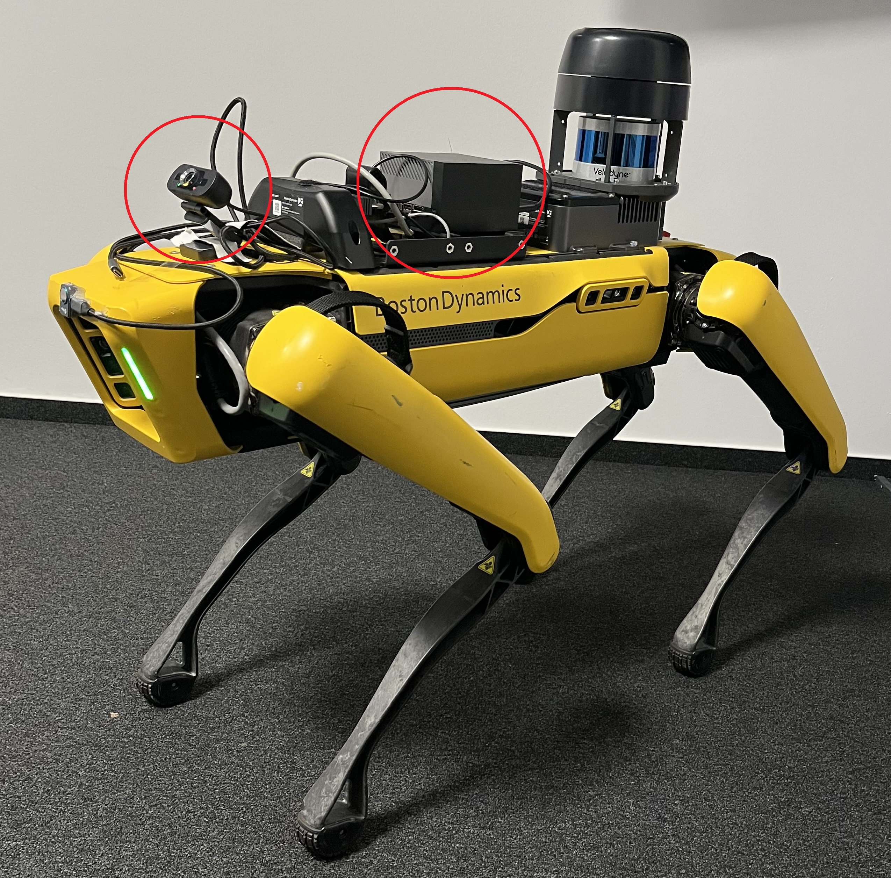
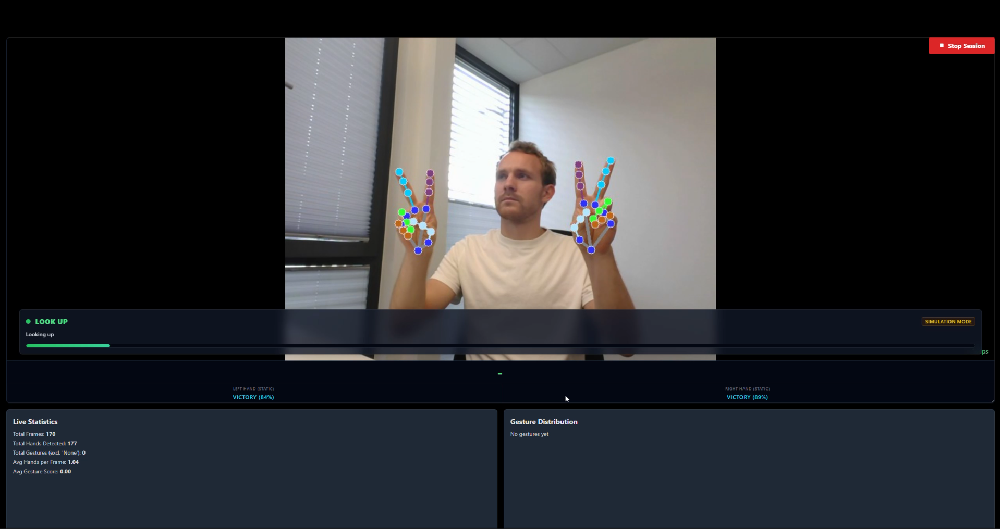
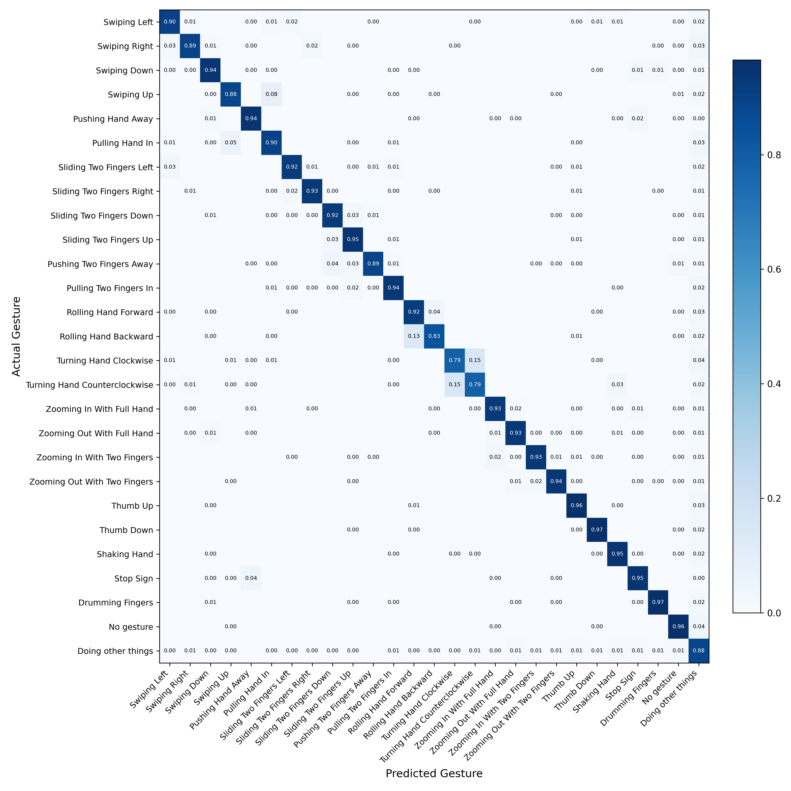
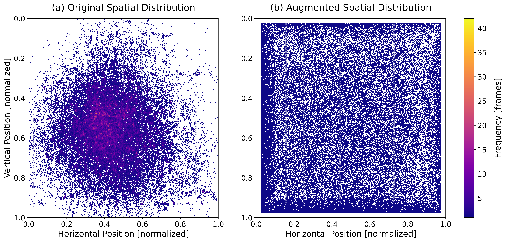
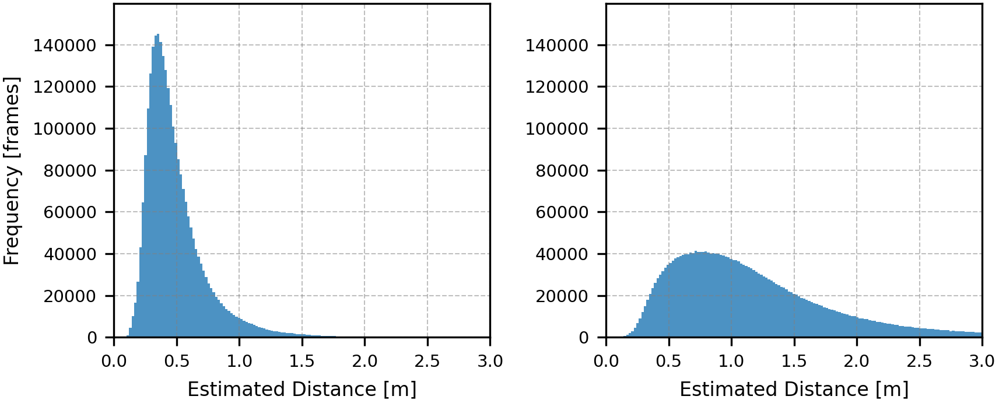

# Quadruped Robot Gesture Control 🤖

[](https://www.python.org/downloads/release/python-3100/)
[](https://pytorch.org/)
[](https://github.com/astral-sh/uv)
[](https://opensource.org/licenses/MIT)

A real-time, low-latency, continuous dynamic gesture recognition system designed to control a Boston Dynamics Spot robot using Edge AI hardware. Developed as part of a Master's Thesis.


*Hardware configuration: The left highlight denotes the external RGB webcam mounted on the payload rails, and the right highlight indicates the NVIDIA Jetson AGX Orin compute module utilized for local gesture processing.*

### 🎥 Demos
**Gesture Control Demo:**
<div align="center">
  <video src="https://github.com/user-attachments/assets/769401e4-50ff-416f-b9f6-be2297379d17" width="300" controls="controls"></video>
</div>


**Web UI Dashboard Demo:**
<div align="center">
  <video src="https://github.com/user-attachments/assets/ed42e41e-c008-4838-8100-09054b39e8f3" width="600" controls="controls"></video>
</div>


This project maps a real-time camera feed to physical robotic movements. By decoupling spatial feature extraction (MediaPipe) from temporal classification (custom PyTorch GRU), the pipeline operates continuously on constrained edge devices while providing an offline-capable MJPEG Web UI for live monitoring and configuration.

---

## 🛠 System Architecture

1. **Video Ingestion**: Local USB or IP stream camera capture.
2. **Spatial Feature Extraction**: MediaPipe isolates hands and extracts sparse 3D skeletal landmarks.
3. **Temporal Classification**: A custom PyTorch GRU analyzes the rolling window of skeletal data to classify dynamic gestures over time.
4. **Hardware Translation**: Identified gestures are translated via the `bosdyn` SDK into physical `RobotCommand` velocity or trajectory actions for the Spot robot.
5. **UI & Web Dashboard**: A Flask + Tailwind CSS interface allows real-time viewing of the AI's internal skeletal tracking alongside dynamic configuration options.

*(For an in-depth breakdown of the networking, architecture, and design constraints, see the [Contextual Architecture Document](docs/architecture.md)).*

---

## 🚀 Installation & Setup

This project uses [uv](https://github.com/astral-sh/uv) as its lightning-fast package manager to resolve strict CUDA and PyTorch dependencies deterministically across ARM64 (Jetson) and AMD64 (Windows/Linux) architectures.

### 1. Clone the Repository
```bash
git clone https://github.com/Bennit99/robot-gesture-control.git
cd robot-gesture-control
```

### 2. Configure Environment Variables
Copy the provided `.env.example` file to `.env` and configure your settings:
```bash
cp .env.example .env
```

**Environment Variables Breakdown:**
- `IP_ADRESSE`: The IP address of the Boston Dynamics Spot robot on your local network (e.g., `192.168.10.3`).
- `SPOT_USERNAME`: The API username for the robot (default is usually `spot`).
- `SPOT_PASSWORD`: Your secret robot API password.
- `FLASK_HOST` & `FLASK_PORT`: Configures the backend Python Flask server binding (default `0.0.0.0:5000`).
- `FRONTEND_HOST` & `FRONTEND_PORT`: Configures the Web UI binding (default `0.0.0.0:8000`).

Ensure you set the correct `IP_ADRESSE` and credentials before attempting to send physical movement commands.

### 3. Setup Virtual Environment (Using UV)
Make sure `uv` is installed, then create your virtual environment and sync the dependencies:
```bash
# Create a virtual environment
uv venv

# Activate it
# Linux/macOS:
source .venv/bin/activate
# Windows:
.venv\Scripts\activate

# Install dependencies deterministically
uv sync --all-groups
```

---

## 🎮 Running the System

### Running via the Setup Script (Edge Deployment)
For automated edge deployments (e.g., on the Jetson Orin Nano), use the included `setup_gesture.sh` script. This handles network connectivity, external drive mounting, sparse-checkout updates, and Docker orchestration automatically:

```bash
# Pull latest changes and run
./setup_gesture.sh --update

# Or simply start the existing container
./setup_gesture.sh
```

### Running Locally (Development)
For local testing and development, you can run the main pipeline directly using `uv`:

```bash
# Start the gesture recognition pipeline and web server
uv run python main.py
```

### Accessing the Web UI
Once the pipeline is running, open your browser and navigate to the web dashboard (default: `http://localhost:5000`). From the UI, you can:
- Observe the real-time MJPEG stream with MediaPipe skeletal overlays.
- Map custom gestures to physical Spot actions.
- Start and stop the gesture control pipeline.
- Hijack the Spot leash / take control of the robot.
- Monitor inference latency statistics.



---

## 🧠 Dataset & AI Training

This repository also contains all the PyTorch source code used to train the temporal classification models (Transformers, Conv1D, STGCN, GRU, LSTM) on the massive Jester dataset.

### 1. Download the Dataset
We utilize the **Jester V1** dataset for training. 
You can download the official dataset from Qualcomm's Developer Portal:
[Download Jester Dataset](https://www.qualcomm.com/developer/software/jester-dataset/downloads)

Extract the dataset and place it in `/data/jester/` alongside the label CSVs. 
The DataLoader (`jester.training.data`) will automatically extract and cache the MediaPipe landmarks for ultra-fast GPU training!

### 2. Train a Gesture Model
To train a temporal classification model (e.g., the GRU) on the dataset:
```bash
# Using uv to manage dependencies and run the training script
uv run python -m jester.training.train --arch gru --batch-size 64
```
On the first run, the DataLoader will automatically parse the raw Jester video dataset and cache all MediaPipe landmarks to disk. Live training metrics and loss curves are automatically streamed to [Weights & Biases (WandB)](https://wandb.ai/).

### 3. Evaluate and Plot
To evaluate a trained model checkpoint and generate a comprehensive classification report:
```bash
uv run python -m jester.training.evaluate --ckpt path/to/model.ckpt
```


*Example Confusion Matrix of the final GRU architecture across the 27 dynamic gesture classes.*

To generate the exact FLOP-scaling charts and spatial distributions (heatmaps/sizes) used in the thesis, run the offline plotting scripts:
```bash
uv run python -m jester.training.plot_flops
uv run python -m jester.plot_heatmap_augmented
uv run python -m jester.plot_size_distribution
```


*(a) Original vs (b) Augmented Spatial Distributions generated by the dataset analysis scripts.*


*Estimated operator distance from the camera. The blue histogram represents the original biased distribution, while the orange curve illustrates the corrected target distribution via augmentation.*

All generated graphics will be automatically saved directly to the `output/plots/` directory.

---

## 📖 Master's Thesis & Citation

For an in-depth mathematical breakdown of the custom GRU architecture, training methodology, and hardware latency constraints, please refer to the full Master's Thesis document:

📄 **[Advancing Human-Robot Interaction with Real-Time Gesture Commands](docs/Masterthesis.pdf)**

If you build upon this work in an academic context, please cite the thesis accordingly.

---
**Note:** *This project is part of a Master's Thesis research project.*